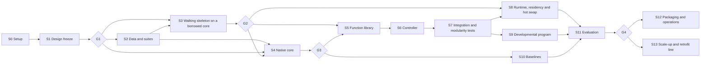

# Flow — Detailed Build Pipeline for a Functionally Modular Model

**Version** 0.3 (draft for review) · **Date** 2026-11-10 · **Implements** `flow-tech-spec.md` v0.2 with the amendments in §9 · **Replaces** `flow-build-pipeline.md` v0.2 once approved · **Approver** the project author (human gates)

This is the procedure for building Flow v0, from an empty repository to an evaluated prototype and a go/stop decision. An orchestrator model with specialist agents can execute it (roles in Annex D), and so can one engineer.

What changed from pipeline v0.2:

1. **A reference design (§2).** Types, registers, the anatomy of a function module, the call loop and the core defaults are fixed concretely enough to code from. Pipeline v0.2 left these to the Architect agent.
2. **Detailed step cards (§4).** Each step gives its procedure with default values and its outputs. Steps that can fail on a measurable quantity carry a numeric pass test, and steps with a known failure mode carry a fallback.
3. **A walking skeleton first (stage S3).** The whole function machinery is built and tested on an existing small open model before any pretraining is paid for.
4. **Separation is enforced and measured.** The core is trained so that it cannot perform the functions itself, and a new metric (M12) tests that each function lives in its module and nowhere else.

**Revised on 2026-11-10 after building and testing the starter kit** (`flow-starter`). The native core is now the Qwen3.5 text architecture, scaled down (§2.7, S4.1, Annex A). A trigger has three outputs: call, operation and final (§2.6, S3.2). Two rules were added, one for trace data (S2.1) and one for trigger training (S3.2). The repository layout is `src/flow/…` (S0.1). The first manifest example carries the measured size of add_exact (Annex C). Amendments 10–12 in §9 record these changes.

**Decisions needed from you at gate G1**

| Decision | Default proposed here |
|---|---|
| Example domain | Clinical dosing text and laboratory units |
| Borrowed core for the skeleton | Qwen3.5-0.8B for development, Qwen3.5-4B as the target (both Apache-2.0) |
| Compute | One rented 24 GB GPU; a spending cap set by the project owner (§6) |
| Teacher model for distilled data | An open-weight model run on the rented GPU |
| Spec amendments | The twelve items in §9 |

---

## 1. Target: what "functionally modular" means here

| Property | Meaning | Test | Metric |
|---|---|---|---|
| Separate | Each function is one pack of files. The core never changes when the library does | Core hash identical before and after every library change | Registry audit |
| Localized | A function lives in its module and nowhere else | Remove the module: its own test suite falls to the floor, the others do not move | M12, M4 |
| Composable | Modules built apart work together, also in combinations never trained | Sealed held-out combinations | M1 |
| Extensible | A function can be added without retraining anything else | Add held-back functions | M3 |
| Loadable | Modules load and unload during generation | Swap tests, residency profile | M5, M11 |
| Developmental | The library differentiates, suppresses and eliminates safely | Lifecycle run | M10 |

**Deliverables of v0:** a frozen core release; a library of 12 function modules, 2 of them domain-bound variants, plus knowledge packs; a reference runtime with residency management and hot swap; operations tools; baselines; an evaluation report against M1–M12; a recorded decision at gate G4.

## 2. Reference design

These are the defaults the steps implement. Items that amend spec v0.2 are listed in §9.

### 2.1 Overview

```
 text ─► tokenizer ─► typed scanner ────────────────┐ typed values of tokens
              │                                      ▼
              ▼                            ┌──────────────────────┐
     Core language model ── hidden ──────► │ Function layer       │
     (frozen; delta skills    states       │  controller block    │ ◄── module library
      attach inside it)                    │  triggers → binders  │     (residency manager:
              │                            │  bodies ⇄ registers  │      fast memory, RAM, SSD)
              ▼                            └──────────┬───────────┘
        core logits ────────────► emitter ◄───────── result
                                     │
                                     ▼
                           next token + trace
```

### 2.2 Terms

| Term | Meaning |
|---|---|
| Typed value | A NUMBER, SYMBOL or FLAG in a fixed, designed code (§2.3) |
| Typed scanner | Deterministic code that reads the token stream and gives the typed value anchored at each token: the number that ends there, or the symbol the token names. It also runs on the model's own output |
| Register | A small named vector that holds one typed value for the current session (§2.4) |
| Trigger | Learned detector that says "function f is needed at this position, now" |
| Binder | Learned pointer that picks a function's arguments: earlier token positions, or the current result |
| Body | The computation itself, from argument registers to a result register: written weights, a table read, or a small trained network |
| Function module | Trigger + binder + body + tests + manifest, shipped as one pack |
| Delta skill | A module that is a low-rank change (LoRA) to declared matrices inside the core, active for a span of text |
| Call loop | At each position, up to four trigger → binder → body cycles, so one function's result can feed the next |
| Emitter | Written code path that prints a typed result as tokens |
| Controller block | One small shared transformer layer over the core's hidden states. It produces the features that all triggers and binders read |
| Borrowed core | An existing open model used, frozen, as a test bench in stage S3 |
| Abstain | The core's own output where a function result is needed: a reserved `<abstain>` token |

### 2.3 Types

| Type | Code (32 dimensions) | Where it comes from | How it is printed |
|---|---|---|---|
| NUMBER | 1 sign dimension; 12 decimal digits, each as (cos, sin) of 2π·digit/10; 7 dimensions for the decimal-point position (0–6 places) | Scanner, at the last token of every number in the text; bodies | Digit by digit, most significant first |
| SYMBOL | A 16-bit symbol id in a ±1 error-correcting code (Reed–Muller RM(2,5): 32 bits, minimum distance 8). The id is the symbol's index in the symbol table, which lists entity names, units and relation words with their tokens | Scanner, for every token listed in the symbol table; bodies | As that symbol's token |
| FLAG | True or false | Bodies | "yes" or "no", or consumed by the next call |

Each value carries 2 extra type-tag dimensions (34 in total). The digit code matches the mod-10 features found in trained models (spec Annex A) and keeps exact arithmetic simple. The symbol code makes decoding a linear map with wide margins. v0 symbols are single tokens; multi-token names wait for v1.

### 2.4 Registers

| Register | Holds | Persists across tokens | Written by |
|---|---|---|---|
| ARG0, ARG1, ARG2 | Arguments of the current call | No | Binder |
| RES | Result of the latest call | Until printed or replaced | Body |
| STATE | 16 key → value slots of typed values | Yes, for the session | State bodies only |
| CTRL | Call counter, print progress, MISS and overflow flags, last function id | Yes | Runtime, bodies, emitter |

Typed values of earlier tokens are not stored. The scanner recomputes them from the tokens when a binder points at them. Session state lives in the registers, not in any module, so a module can be unloaded and reloaded without losing state.

### 2.5 Module kinds

| Kind | v0 examples | Attaches at | Reads → writes | Learned part | Swap rule |
|---|---|---|---|---|---|
| Register function | add_exact, compare_numeric, successor, unit_convert | Function layer | ARG → RES | Trigger, binder | Any token |
| Lookup function | fact_lookup | Function layer; rows stay on SSD | ARG → RES | Trigger, binder | Any token; rows are paged one entity at a time |
| State function | bind_track | Function layer | ARG, STATE → STATE, RES | Trigger, binder | Any token |
| Delta skill | extract_slots, rule_induce | Query, output and MLP matrices of declared core layers | Core computation over a span | Trigger, LoRA weights | Any token (`kv_write: false`); trained with random switch-on points |
| Regulator | know_gate, refuse_gate | Function layer | Flags and controller features → RES | Probe | Any token; critical ones are pinned in fast memory |

A body of a register, lookup or state function depends only on the type system, so it is **portable across cores**. Only triggers, binders and delta skills are fitted to one core release.

### 2.6 Call loop

```text
for each new position p:
    h       = core(tokens[0..p])                  # frozen; KV-cached; delta skills act inside
    c, keys = controller_block(h)                 # shared features and binder keys, cached per position
    final   = true
    for step in 1..max_calls:                     # max_calls = 4
        f = arbitrate("call" scores of resident modules, given c and CTRL)
        if f is none: break
        if f is not resident: f = fallback(f)     # domain variant → generic parent → abstain
        op, final = trigger_f(c, CTRL)            # which operation; does this call complete the chain?
        ARG = binder_f(c, keys[0..p])             # hard pointers to earlier tokens or to RES
        RES, STATE = body_f(op, ARG, STATE)       # may read pack rows from SSD
        trace.append(p, step, f, op, pointers, RES, final)
    if RES holds an unprinted value and final: next token = emitter(RES, CTRL)    # overrides core logits
    else:                                      next token = sample(core logits)  # <abstain> where a result is needed
```

A trigger has three outputs: *call* (whether the module acts now), *operation* (which of its operations) and *final* (whether this call completes the chain). Whether and which are separate, so that a pair of calls never shown in training can still work. A chain whose last call is not final is dropped and the model abstains. This is what happens when the module that should continue is not loaded.

A printed result re-enters the context as ordinary tokens, and the scanner gives it a typed value again, so later calls can point at it.

### 2.7 Core defaults (native core, stage S4)

| Item | Default |
|---|---|
| Tokenizer | BPE with 8,192 pieces, every digit its own token; up to 8,192 added whole-word symbol tokens (entity names, units); reserved `<abstain>`, `<unknown>`, `<refuse>` |
| Architecture | The Qwen3.5 text network (`Qwen3_5ForCausalLM` in Transformers, Apache-2.0), built from a modified configuration without trained weights. The borrowed core of stage S3 and the native core share code and interface |
| Width, heads, MLP | 512; full-attention layers with 8 heads of 64 and 2 key/value heads; linear-attention layers with 8 heads of 64; gated MLP of 1,344 with three matrices (SiLU), the size of a 2,048 two-matrix MLP |
| Layers | 2 entry + 4 looped + 2 exit. The looped group runs 3 times: 16 layer passes per token. Layer kinds follow the published order of 3 linear-attention layers (L, Gated DeltaNet) to 1 full-attention layer (F): entry LL, loop LFLL, exit LF. Loop passes are layer objects that share parameters |
| Attention | Causal; rotary positions on a quarter of each head's dimensions; a sigmoid gate on the attention output |
| Local mixing | A causal convolution over the current and 3 previous tokens inside every linear-attention layer (12 of the 16 passes). Separate Canon layers are not used in v0 |
| Norms | RMSNorm before each sublayer and before the unembedding |
| Number input | The scanner's NUMBER code enters the token embedding at number-end tokens through one learned linear map |
| Parameters | 34.7M unique (26.3M in 8 layers + 8.4M tied embedding); 69 MB at 16 bits |
| Compute | ≈ 1.1 × 10⁸ FLOPs per token, forward |
| Controller block | 1 layer, width 256, 4 heads, on a learned mix of core layers; ≈ 0.9M parameters |

### 2.8 How separation is enforced

1. **The core never learns the functions.** During core pretraining, every result span in the task text is excluded from the loss, and the position just before it is trained to predict `<abstain>`. The core learns the language of the tasks and where a result is needed, never the result.
2. **Every module is built alone.** Its trigger, binder and body are written or trained with the core frozen and all other modules absent or replaced by ground-truth results.
3. **Modules touch only declared surfaces.** Register, lookup and state functions read and write registers only. Delta skills change only the declared matrices. Nothing writes into the core's weights or its key/value cache.
4. **Separation is measured.** Removing a module must destroy its own function and leave the others intact (S7.3).

| Component | Learned from data | Written or computed |
|---|---|---|
| Core language model | Yes (base text, answer-masked) | |
| Scanner, codes, emitter | | Yes |
| Controller block | Yes | |
| Trigger and binder of each function | Yes (small; supervised by traces) | |
| Bodies of exact functions | | Yes (constructed weights) |
| Lookup rows | Optional experiment | Yes (written from tables) |
| Delta skills | Yes (LoRA) | |
| State | | Yes (slot memory over STATE) |

### 2.9 Precedents

Three published systems show the mechanism works for one function at a time. [IGC](https://arxiv.org/abs/2501.00684) adds a calculator to a frozen Llama 3.1 8B: a small attention module extracts the operands from hidden states under an auxiliary loss, the exact result is injected back, and accuracy on BigBench arithmetic reaches 0.99 with 17M added parameters. [OccamLLM](https://arxiv.org/abs/2406.06576) lets the hidden states of a frozen Llama 3 select an exact operation, with a learned switch between model and module, and reports 100% on single arithmetic operations. [Neural Comprehension](https://arxiv.org/abs/2304.01665) plugs compiled networks into a language model behind a gate. Flow turns these single-function devices into a typed, loadable library with composition, a lifecycle, and a core trained not to duplicate its modules.

## 3. Roadmap



| Stage | Purpose | Elapsed* | GPU-hours* |
|---|---|---|---|
| S0 | Setup | 2–3 days | 0 |
| S1 | Design freeze | ~1 week | 0 |
| S2 | Data and suites | 1–1.5 weeks | 5–10 |
| S3 | Walking skeleton on a borrowed core | ~1 week | 5–10 |
| S4 | Native core | 1–2 weeks | 15–25 |
| S5 | Function library | 2–3 weeks | 10–15 |
| S6 | Controller | ~1 week | 3–5 |
| S7 | Integration and modularity tests | ~1 week | 5–10 |
| S8 | Runtime, residency and hot swap | 2–3 weeks, in parallel from G2 | 2–5 |
| S9 | Developmental program | ~1 week | 3–5 |
| S10 | Baselines | In parallel from G3 | 60–100 |
| S11 | Evaluation and decision | ~1 week | 10–15 |
| S12, S13 | Packaging; next steps (only if go) | 1–2 weeks | — |
| **Total** | | **10–14 weeks** | **118–200** |

*Estimates for an agent team and one 24 GB GPU; step S0.4 replaces them with a costed plan.

| Gate | After | You decide |
|---|---|---|
| G1 | S1 | Vocabulary, types, contract, targets, example domain, budget |
| G2 | S3 | Whether the mechanism works on a borrowed core: continue to the native core, stay on the retrofit line, or stop |
| G3 | S4 | Accept the native core and core release 1.0 |
| G4 | S11 | Go, pivot or stop |

## 4. Stages and steps

Step cards use: **Needs** (steps or gates that must be done first) · **Do** · **Out** · **Pass** · **If it fails**. A step is done only when its pass test holds and its outputs are registered.

### S0 — Setup

#### S0.1 Repository and layout · OPS
- **Needs:** —
- **Do:**
  1. Create the repository:
     ```
     flow-starter/
       src/flow/   typesys/  bodies/  core/  borrowed/  function_layer/  data/  registry/  runtime/
       library/<module-id>/   specs/   configs/   scripts/   ops/   dashboards/   docs/
       data/   evals/   evals/sealed/   reports/   runs/   tests/
     ```
     The type system package is `typesys`: a top-level folder named `types` hides Python's standard module of that name. The starter kit delivers this layout with the type system, two written bodies, the blank and the borrowed core, the function layer, a registry and a minimal runtime.
  2. Set up CI: lint, unit tests, contract tests, and a guard that fails if the core release hash changes without a version bump.
  3. Make `evals/sealed/` readable by the Evaluator only.
- **Out:** repository, CI.
- **Pass:** CI is green on the empty skeleton.

#### S0.2 Environment pins · RES + OPS
- **Needs:** S0.1
- **Do:**
  1. Use Python 3.12 (PyTorch 2.15 needs ≥ 3.11).
  2. Write a lockfile with the versions current on PyPI on 2026-11-09: torch 2.15.0, transformers 5.22.2, peft 0.21.2, tokenizers 0.23.3, datasets 5.2.0, safetensors 0.8.0, mlflow 3.18.0, nnsight 0.8.2, hypothesis 6.170.15, fastapi 0.162.2. Optional: flash-linear-attention 0.6.0 for learned state bodies (its Triton kernels are GPU-only). Tracr is needed only if sequence programs are compiled; it is not on PyPI, so install it from GitHub in a separate environment with the JAX and Haiku versions its repository states. Re-check all versions on the day of pinning.
  3. Targets: training in a Linux container with CUDA. Inference on Windows on Arm (PyTorch wheels come from the PyTorch package index, not PyPI), Windows x86, Linux and a Pi-class board.
  4. Write `ops/compat_check.py`. It checks OS, Python, CPU features, RAM, GPU and free disk, and prints what is missing instead of crashing.
- **Out:** `ops/lockfile`, `ops/compat_check.py`.
- **Pass:** clean install in a fresh container; the check runs on every target.

#### S0.3 License and terms audit · RES
- **Needs:** S0.1
- **Do:** confirm each license at its source and record it. New items in this version:

| Component | Use | License or terms | Note |
|---|---|---|---|
| Qwen3.5-0.8B | Borrowed core for development (S3) | Apache-2.0 | Multimodal model; use the language model only. 24 layers, width 1,024; 0.75B parameters in the text network |
| Qwen3.5-4B | Target borrowed core (S3, S13) | Apache-2.0 | 32 layers, width 2,560; 4.2B parameters in the text network |
| Qwen3.5 model code in Transformers | Architecture of the native core (S4) | Apache-2.0 | Built from a modified configuration, without the published weights |
| TinyStories | Base text | CDLA-Sharing-1.0 | Data derived from it must be shared under the same terms |
| openFDA drug labels | Domain text, dosing sentences | CC0 1.0 | No patient data. Do not imply FDA endorsement |
| PMC Open Access subset, commercial-use collection | Optional domain text | Per article (CC0, CC BY and similar) | Keep each article's license in the data card |
| Components audited in pipeline v0.2, S0.3 | Unchanged | Unchanged | PyTorch, Transformers, PEFT, nnsight, Tracr, Neural Comprehension, Engram reference code, flash-linear-attention, llama.cpp, MLflow |

- **Out:** `LICENSES.md`, `ops/teacher_terms.md` (terms of the teacher model, including whether its outputs may be used for training).
- **Pass:** no unresolved license or terms issue on the critical path.

#### S0.4 Compute and cost plan · ORC
- **Needs:** S0.2, S0.3
- **Do:** choose the GPU provider; turn §6 into a budget per stage with alert thresholds at 80% and 100%; plan storage (about 60 GB).
- **Out:** `ops/budget.md`.
- **Pass:** you acknowledge the budget.

#### S0.5 Operations skeleton · OPS
- **Needs:** S0.1
- **Do:**
  1. Start an MLflow server for runs and artifacts.
  2. Create the registry (SQLite): modules, versions, tests, provenance, licenses, status, telemetry.
  3. Add the status board (`ops/status.json`), an append-only audit log, and a snapshot and rollback command for core plus library.
  4. Draw mockups (static HTML, light theme) of the registry view, the trace viewer and the residency monitor. Show them to the human before building anything. Each view loads a skeleton or cached state first, then streams fresh data.
  5. Define import and export: datasets, module packs, library snapshots, reports.
- **Out:** `registry/registry.db`, `ops/` services, `dashboards/mockups/`.
- **Pass:** a dummy module registers and appears on the board; mockups approved.

### S1 — Design freeze (gate G1)

#### S1.1 Claims and kill criteria · ARC
- **Needs:** S0.3
- **Do:** write five falsifiable claims, one per property of §1 (separate and localized; composable; extensible; loadable; developmental). Map each to metrics M1–M12 with its kill criterion.
- **Out:** `specs/claims.md`.
- **Pass:** every claim has at least one metric and one kill criterion.

#### S1.2 Vocabulary and signatures · ARC
- **Needs:** S1.1
- **Do:** fix the v0 vocabulary. Default:

| Function | Kind | Signature | Body route |
|---|---|---|---|
| add_exact (add, subtract) | Register function | (NUMBER, NUMBER) → NUMBER | Programmed |
| compare_numeric | Register function | (NUMBER, NUMBER) → FLAG | Programmed |
| successor | Register function | (NUMBER) → NUMBER; (SYMBOL) → SYMBOL | Programmed; written table for weekdays, months, letters |
| unit_convert | Register function | (NUMBER, SYMBOL, SYMBOL) → NUMBER | Programmed (SI prefixes are digit shifts) |
| unit_convert@lab | Domain variant of unit_convert | Same | Programmed, with a written table of analyte factors |
| fact_lookup | Lookup function | (SYMBOL, SYMBOL) → SYMBOL or NUMBER | Written rows |
| bind_track (bind, query) | State function | (SYMBOL, SYMBOL) → none; (SYMBOL) → SYMBOL | Programmed slot memory |
| extract_slots | Delta skill | Span → text record | Distilled LoRA |
| extract_dosing@clinical | Domain variant of extract_slots | Same | Distilled LoRA stacked on the parent |
| rule_induce | Delta skill | Examples → output | Trained LoRA |
| know_gate | Regulator | MISS or low confidence → `<unknown>` | Rule plus probe |
| refuse_gate | Regulator (critical) | Probe → `<refuse>` | Trained probe |
| two_hop, count_items | Compositions | — | No module: the call loop chains fact_lookup twice, or applies successor to a counter in STATE |
| max_min, and the pack `kb.heldout` | Held back | (NUMBER, NUMBER) → NUMBER | Built only in the add-a-function trial (S9.6) |

- **Out:** `specs/vocabulary.yaml`, including the list of signature classes.
- **Pass:** every signature uses only the types of §2.3; every domain variant names its parent.

#### S1.3 Type system, scanner and emitter · ARC + PRG
- **Needs:** S1.2
- **Do:**
  1. Implement the NUMBER and SYMBOL codecs and the FLAG code (§2.3) in `types/`, with encode, decode and validity checks.
  2. Implement the typed scanner. A number is an optional sign, digits and an optional decimal part; thousands separators are removed. The anchor is the number's last token. Every token listed in the symbol table has a SYMBOL value. The scanner must work incrementally on generated tokens.
  3. Implement the emitter. NUMBER: sign, digits from the most significant non-zero place, decimal point and fraction when present, one token per character, with progress kept in CTRL. SYMBOL: the decoded token. FLAG: "yes" or "no". While the emitter is printing, its token replaces the core's choice; otherwise core logits pass through unchanged.
  4. Test: encode → decode on 10⁶ random numbers plus boundary cases (0, all nines, negatives, every decimal position); every symbol id; print → scan closure (what the emitter prints, the scanner reads back as the same code). Run in 32-bit and 16-bit floats.
- **Out:** `types/`, `tests/types/`, `specs/types.md`.
- **Pass:** 100% on all tests in both precisions.

#### S1.4 Module contract and manifest schema · ARC + OPS
- **Needs:** S1.3
- **Do:**
  1. Write `specs/contract.md`: registers and who may write each (§2.4); module kinds and the surfaces they may touch (§2.5); call-loop order; arbitration; the fallback chain; swap rules; invariants (a module that is absent or not triggered changes nothing, bit for bit; register writes are type-checked; execution is deterministic); versioning (semantic; each module declares the contract range and the core release it was fitted to).
  2. Extend the manifest schema of spec §4.3 with `kind`, `signature`, `trigger`, `binder`, `body`, `fitted_to` and `portable_body` (examples in Annex C).
  3. Write contract-test templates: no-op identity, type checks, determinism, swap at a random token, behavior when the module is absent.
- **Out:** `specs/contract.md`, `specs/manifest.schema.json`, `tests/contract/`.
- **Pass:** the schema validates the Annex C examples; the contract tests run against a dummy module.

#### S1.5 Test specifications · ARC + EVL
- **Needs:** S1.2, S1.4
- **Do:**
  1. For each function, specify the unit suite (inputs, expected outputs, size, exhaustive or sampled) and property tests, for example a + b = b + a, (a + b) − b = a, and antisymmetry of comparison.
  2. Specify composition cases and shift cases.
  3. The Evaluator writes sealed variants with its own seeds and templates.
- **Out:** `tests/functions/<id>/`, `evals/sealed/<id>/`.
- **Pass:** every function has unit, property, composition and shift tests, each with a sealed variant.

#### S1.6 Targets and gate packet G1 · ORC
- **Needs:** S1.5, S0.4, S0.5
- **Do:** fix numeric targets for M1–M12 (§5), the parameter counts the baselines must match, ε for elimination, usage threshold θ and window W for suppression, and the swap tolerance.
- **Out:** gate packet. **G1 (you):** approve vocabulary, types, contract, targets, example domain and budget.

### S2 — Data and suites

#### S2.1 World generator · DAT
- **Needs:** G1
- **Do:**
  1. Build a seeded generator of a small world: 6,000 entities with single-token names, which fits the symbol-token budget of §2.7; 8 relations and their facts; numbers of 1–8 digits with units; events that bind and move things (for state); ordered sets (weekdays, months, letters). Reserve 500 entities that never appear in training text, for the shift suite.
  2. Define a grammar of function calls over this world: single calls for every function, and nested calls up to depth 3 wherever the types match.
  3. Produce surface text from templates: at least 20 per function and per nesting pattern. Then have the teacher model write 20–50 paraphrases of each. Accept a paraphrase only if an automatic check finds every slot exactly once and every number unchanged.
  4. Attach a trace to every record: for each call, its token position, call step, function, the pointer of each argument (a token index, or RES), the result, and whether it is printed; plus the spans of result tokens (Annex B).
  5. Add difficulty controls: digits, nesting depth, distractor numbers and entities, distance between an argument and its call.
  6. Vary every factor in every context. Each operation of a function appears after at least two different preceding calls, and each preceding call is followed by at least two different operations. A held-out combination is chosen so that each of its parts varies elsewhere in training. In the starter's toy run, a chain was learned as a fixed pair until this held: the pair never shown in training went from 0–56% to 97–100% exact.
- **Out:** `data/generators/`, `data/task/` (about 5M records, 300M tokens), data card.
- **Pass:** 1,000 sampled records, re-executed by a reference interpreter, reproduce their results exactly; every pointer lands on a token of the right type.

#### S2.2 Composition splits and sealed suites · DAT + EVL
- **Needs:** S2.1
- **Do:**
  1. List all type-compatible ordered pairs of functions (expect 30–50) and the chains of three.
  2. Hold out 30% of the pairs, and every chain that contains one of them, from all training data. The Evaluator picks them with a private seed.
  3. The Evaluator builds the sealed suites: per function (1,000 items each); held-out pairs (5,000); chains of three in unseen arrangements (2,000); long numbers of 9–12 digits, with training limited to 8 (2,000); shift, meaning unseen paraphrases and unseen entity names (2,000); a natural mini-set of 200 hand-checked items; general text (1M tokens) for false-trigger rates. Chains of four are reported as a stretch result, not a target.
  4. Optional external suites for comparison with the literature: [SCAN](https://arxiv.org/abs/1711.00350) and [COGS](https://arxiv.org/abs/2010.05465).
- **Out:** `data/splits.json`, `evals/sealed/`.
- **Pass:** no held-out pair appears in any training record, checked on traces, not on text.

#### S2.3 Base text and tokenizer · DAT
- **Needs:** S2.1
- **Do:**
  1. Assemble the base mixture for the native core, by tokens: 60% stories (TinyStories), 30% task text from S2.1 (training split), 10% unlabeled domain text (openFDA label sections; optionally methods sections from the PMC commercial-use collection).
  2. Train the tokenizer on the mixture: 8,192 BPE pieces, digits never merged. Add the symbol tokens (entity names, units, relation words) and the reserved tokens. Write the symbol table (symbol id → token).
  3. Mark the result spans of the task text, from the traces, for answer masking in S4.2.
- **Out:** `data/base/`, `core/tokenizer/`, `types/symbols.json`, data cards with licenses.
- **Pass:** every number tokenizes into single digits; every entity name and unit is one token.

#### S2.4 Domain data · DAT
- **Needs:** G1
- **Do:**
  1. Dosing sentences: take "dosage and administration" text from openFDA drug labels, split it into sentences, keep those with a dose pattern.
  2. Label dose, unit, route and frequency with rules, then with the teacher model. Keep items where both agree. Spot-check 200 by hand; require ≥ 95% correct.
  3. Laboratory conversions: build a table of analytes with their factors between conventional and SI units from a public reference, record the source, and generate questions from it.
  4. Use no patient-level data anywhere.
- **Out:** `data/domain/extract_dosing/` (≥ 20,000 labeled sentences), `data/domain/lab_units/`, data cards.
- **Pass:** the hand check reaches ≥ 95%; every conversion factor has a recorded source.

#### S2.5 Knowledge tables · DAT
- **Needs:** S2.1
- **Do:** export the world's facts as tables (entity, relation, type, value) in three sets: `kb.general` (about 36,000 facts), `kb.domain` (6,000) and `kb.heldout` (6,000, used only in S9.6).
- **Out:** `data/kb/`.
- **Pass:** the three sets share no fact; every value is a valid typed value.

#### S2.6 Library scale-out set · DAT + SYS
- **Needs:** S2.5
- **Do:** generate 1,000 synthetic packs for residency tests: 900 knowledge packs of 10–50 MB and 100 dummy delta skills of 1–20 MB (20–40 GB in total). The real v0 packs are only a few megabytes, so this set is what makes the residency measurements meaningful. Write a workload script of 10⁵ calls with Zipf-distributed pack use and realistic span lengths.
- **Out:** `data/scaleout/`, `runtime/workloads/zipf.py`.
- **Pass:** the workload replays identically from its seed.

#### S2.7 Data audit · EVL
- **Needs:** S2.2, S2.3, S2.4, S2.5
- **Do:** check contamination against the sealed suites, leakage of held-out pairs, and licenses.
- **Out:** `reports/data-audit.md`.
- **Pass:** zero sealed items in any training set; the Evaluator signs off.

### S3 — Walking skeleton on a borrowed core (gate G2)

Purpose: prove the whole function layer, end to end, on a model that already exists. The function layer needs only hidden states and token ids. Everything built here carries over to the native core unchanged, except the parts fitted to one core: the controller block, the triggers and binders, and the delta skill.

#### S3.1 Borrowed-core harness · TRN + SYS
- **Needs:** G1
- **Do:**
  1. Load Qwen3.5-0.8B, language model only, frozen, in 16-bit floats. Check the Transformers version its model card requires.
  2. Expose the hidden states of all layers. Run the typed scanner on its tokenizer, with a symbol table built from words that are single tokens in it. Confirm that the ten digits, "yes" and "no" exist as single tokens; otherwise map the emitter to that tokenizer's pieces.
  3. Build the function-layer scaffold: controller block (on a learned mix of layers), registers, call loop, emitter override, trace.
  4. No-op test: with the function layer attached and no trigger firing, the logits equal the plain model's bit for bit on 10,000 sequences.
- **Out:** `function_layer/`, `core/borrowed/`.
- **Pass:** identity holds; hidden-state throughput is measured, to size S3.2.

#### S3.2 First module end to end: add_exact · CTL + PRG
- **Needs:** S3.1, S2.7
- **Do:**
  1. Body: construct the add and subtract weights and run their exhaustive tests. This is the first run of the procedure in S5A.1–S5A.3.
  2. Data: 100,000 task records for add and subtract in the borrowed core's token space, with entity names limited to its single tokens.
  3. Train controller block, trigger and binder together, core frozen. The trigger has three outputs: call (binary cross-entropy), operation (cross-entropy over the module's operations) and final (binary cross-entropy: does this call complete the chain). Average the call loss separately over plain positions and over call sites. At call sites, the steps of other functions and the step after the last call are the hard negatives; averaged together with the plain positions they are outvoted, and chains of different operations fail (3–7% exact in the starter's toy run, 100% after the change). Binder loss: cross-entropy over pointer targets. AdamW, learning rate 1e-3, 3–5 epochs.
  4. Decode with hard pointers (argmax), so arguments are copied exactly.
- **Out:** `library/fn.add_exact.v1/`.
- **Pass (development set):** trigger F1 ≥ 0.98; pointer accuracy ≥ 0.99; end-to-end exact match ≥ 0.97 on numbers up to 12 digits, although training used at most 8.
- **If it fails:** feed more layers into the mix; give the trigger its own attention pooling; as a last resort for binders, use the rule "the nearest numbers", as OccamLLM does.

#### S3.3 One module of each other kind · PRG + TRN
- **Needs:** S3.2
- **Do:**
  1. Lookup: write a small knowledge pack (10,000 facts) and fit fact_lookup. Test two-hop questions through the call loop on held-out relation pairs.
  2. State: bind_track with the slot-memory body; fit its triggers and binders.
  3. Delta skill: extract_slots as a rank-16 LoRA on the MLP matrices of the borrowed core's middle layers, trained on 5,000 examples with random switch-on points.
- **Out:** three more module packs in `library/`.
- **Pass:** lookup exact match ≥ 0.97; two-hop on held-out pairs ≥ 0.90; state queries ≥ 0.95 at twice the training length; extraction beats the unmodified model on the development set.

#### S3.4 Hot swap and trace demo · SYS
- **Needs:** S3.3
- **Do:**
  1. Write a minimal runtime: incremental decoding, modules as files, load and unload between tokens, fallback to the parent or to abstain while a module is absent.
  2. Test equivalence: a module loaded at token t gives the same outputs as the same module resident but disabled until t.
  3. Build trace viewer v0 from the approved mockup: per token, which trigger fired, the pointers and the result.
- **Out:** `runtime/minimal/`, `dashboards/trace_viewer/`.
- **Pass:** equivalence is exact for register, lookup and state modules and within tolerance for the delta skill; zero stalls in 1,000 scripted swaps.

#### S3.5 Skeleton evaluation and gate packet G2 · EVL + ORC
- **Needs:** S3.4
- **Do:**
  1. Run the sealed suites that apply: per function, long numbers, shift, held-out two-hop pairs, general-text false triggers.
  2. Report per-function accuracy, trigger precision and recall, pointer accuracy, false triggers per 10,000 tokens of general text (target ≤ 1), cost added per token, and a removal test for each module (its suite drops to the base model's level; the others stay the same).
- **Out:** `reports/skeleton.md`, gate packet. **G2 (you):** A, continue to the native core (default if all tests pass); B, stay on the retrofit line only; C, stop.

### S4 — Native core (gate G3)

#### S4.1 Core implementation · TRN + ARC
- **Needs:** G1
- **Do:**
  1. Build the model of Annex A from the Qwen3.5 text architecture (`src/flow/core/blank.py` in the starter kit: entry, looped and exit groups with shared loop parameters, gated attention, partial rotary positions, hidden-state taps). Add what the starter does not have yet: a loop-index embedding at the start of each pass; the number-code input map; a check of the KV cache with shared loop layers; hooks for delta skills on query, output and MLP matrices.
  2. Unit tests: causality (changing a later token never changes an earlier output); cached decoding equals full recomputation; the loop count can change at inference; a LoRA hook with zero weights changes nothing.
- **Out:** `core/model.py`, `tests/core/`.
- **Pass:** all unit tests; one training step runs in bf16 within GPU memory.

#### S4.2 Answer-masked pretraining · TRN
- **Needs:** S4.1, S2.7, G2
- **Do:**
  1. Data: the S2.3 mixture, 2 × 10⁹ tokens in total (2–3 passes over the data).
  2. Loss: next-token cross-entropy. In task text, the position before each result span is trained to predict `<abstain>`, and the remaining result tokens carry no loss. Result tokens stay in the input.
  3. Recipe (Annex A): AdamW; peak learning rate 6e-4, after a sweep from 3e-4 to 1e-3 on 5% of the budget; weight decay 0.1; 2,000 warm-up steps; cosine decay to 10%; 65,536 tokens per step with 2 accumulation steps; bf16; gradient clipping at 1.0; loop count sampled from 2, 3 and 4 per batch.
  4. Train 3 seeds. Checkpoint every 2 × 10⁸ tokens. Log the loss on stories, task text and domain text separately.
- **Out:** `core/checkpoints/`.
- **Pass (development set):** story perplexity within 5% across seeds; `<abstain>` predicted at ≥ 98% of call sites and at ≤ 0.5% of other positions.
- **Cost:** about 7 × 10¹⁷ FLOPs per seed, 4–8 hours on a 24 GB card.

#### S4.3 Core verification · EVL
- **Needs:** S4.2
- **Do:**
  1. Language: held-out story perplexity; 200 sampled continuations rated for fluency by the teacher model against a rubric, with 20 checked by hand.
  2. Primitives, with nnsight: previous-token, induction and retrieval behavior on synthetic probes. On repeated random sequences, accuracy on the second repeat must be ≥ 0.9.
  3. No attention sinks: mean attention on the first token ≤ 10% across heads.
  4. Function exclusion: on every function suite, the core alone scores at the floor (≤ 2% exact match).
- **Out:** `reports/core-verification.md`.
- **Pass:** all four.
- **If it fails:** when the core computes results by itself, find the leak in the answer masks and retrain. When primitives are missing, add repeated-span and bursty sequences to the mixture and retrain.

#### S4.4 Freeze the language core · ARC + OPS
- **Needs:** S4.3
- **Do:** pick the seed with the median development loss and keep the others for variance estimates. Record its SHA-256, make it read-only, and enable the CI guard.
- **Out:** `core/release/language_core.safetensors` with its hash.
- **Pass:** CI rejects any later change to the file.

#### S4.5 Controller block · CTL
- **Needs:** S4.4
- **Do:**
  1. Generate 40 auxiliary functions: made-up names, random signatures drawn from the vocabulary's signature classes, random table bodies, and their own templates. They exist only to make the block's features general.
  2. Train the controller block together with triggers and binders for the training functions and the auxiliary ones, on the frozen core, taking results from the traces in place of bodies.
  3. Freeze the block. Delete the auxiliary triggers and binders.
  4. Check generality: fit triggers and binders for two fresh auxiliary functions on the frozen block.
- **Out:** `core/release/controller_block.safetensors`.
- **Pass:** the two fresh functions reach trigger F1 ≥ 0.97 and pointer accuracy ≥ 0.98 with the block frozen.

#### S4.6 Core release 1.0, port of the skeleton, gate packet G3 · TRN + EVL + ORC
- **Needs:** S4.5
- **Do:**
  1. Assemble core release 1.0: language core, controller block, tokenizer, type system, emitter and contract 1.0, under one hash.
  2. Port the S3 modules. Keep the bodies byte-identical. Refit only the triggers and binders, and retrain the delta skill, on the native core.
  3. Re-run the S3.5 report on the native core, next to the borrowed-core numbers.
- **Out:** `core/release/1.0/`, `reports/core.md`, gate packet. **G3 (you):** accept the release, or allow one revision (larger core, longer training).
- **If it fails:** when the native core's features support triggers worse than the borrowed core's, raise the width to 640 (about 50M parameters) or extend pretraining, once. If it still fails, continue on the retrofit line.

### S5 — Function library

**Definition of done for every module:** manifest valid against the schema; body tests pass (programmed bodies: 100%); trigger and binder meet their thresholds; contract tests pass (no-op identity, type checks, determinism, swap at a random token, absence); cost recorded (parameters, bytes, FLOPs per call); provenance and license recorded; registered with status Prototype.

Bodies do not depend on any core, so lanes A, B and C start their body steps right after G2. Steps that fit triggers and binders wait for G3. Unless a card says otherwise, the output of every S5 step is the module pack in `library/<id>/` and its registry entry.

**Lane A — programmed register functions**

#### S5A.1 Body specifications · PRG
- **Needs:** G2
- **Do:** for each programmed function, write a reference implementation in plain Python (the oracle) and a layer plan: which register dimensions each layer reads, which units it computes, and what it writes.
- **Out:** `library/<id>/reference.py`, `library/<id>/layer_plan.md`.
- **Pass:** each reference passes the unit and property tests of S1.5.

#### S5A.2 Weight construction · PRG
- **Needs:** S5A.1
- **Do:** build the weight tensors with a constructor script (NumPy), never by gradient descent. A frontier model may write the script.
  1. Addition: decode each digit pair to one-hot with 10 ReLU units; sum the two digits of each place; compute carries by look-ahead in two threshold layers (generate and propagate flags per place, then one unit per pair of source and target place); add the carry; reduce modulo 10 with indicator units; re-encode as pairs.
  2. Subtraction: compare magnitudes, borrow look-ahead, set the sign.
  3. Comparison: find the most significant differing place with priority units.
  4. Successor: addition of the constant 1; a written table for ordered symbols.
  5. Unit conversion: an SI prefix change is a move of the decimal point, or a fixed shift of digit places, selected by the two unit symbols.
  6. Laboratory variant: multiply by the analyte's constant with partial-product tables and an adder tree; round half up at the target decimal position.
- **Out:** `library/<id>/body.safetensors`, `library/<id>/construct.py`.

#### S5A.3 Body verification · PRG
- **Needs:** S5A.2
- **Do:**
  1. Addition and subtraction: all 3¹² = 531,441 carry patterns (each place generating, propagating or absorbing a carry); all digit pairs; 10⁶ random operand pairs; the algebraic identities of S1.5.
  2. Comparison: every position of the first differing digit, both directions, and equality.
  3. Unit conversion: every prefix pair; laboratory variant: every analyte in the table at 1,000 values, against a decimal reference.
  4. Repeat everything in 16-bit floats. The Evaluator runs a sealed variant.
- **Pass:** 100% (M9).

#### S5A.4 Triggers and binders for programmed functions · PRG + CTL
- **Needs:** S5A.3, G3
- **Do:** fit each function's trigger and binder on its training records with core release 1.0 frozen, taking other functions' results from the traces. Set the decision threshold on the development set. Register as Prototype.
- **Pass:** trigger F1 ≥ 0.98; pointer accuracy ≥ 0.99; sealed per-function suite ≥ 0.97 exact match.

**Lane B — lookup**

#### S5B.1 Knowledge-pack format and writer · PRG + SYS
- **Needs:** G2, S2.5
- **Do:**
  1. Define the pack: rows grouped by entity; each row holds a 16-bit fingerprint, a relation id, a type tag and a value code; an index maps an entity hash to a byte range. Store as safetensors, read through a memory map. An absent key returns the MISS flag.
  2. Write the tool that turns a table from S2.5 into a pack.
  3. Write the reader: one read returns all rows of an entity.
- **Out:** `runtime/packs/`, `library/kb.general.v1/`, `library/kb.domain.v1/`.
- **Pass:** 100% recall on all written facts; zero false hits on 10⁶ absent keys; one read per entity.

#### S5B.2 fact_lookup function · PRG + CTL
- **Needs:** S5B.1, G3
- **Do:** fit the trigger and the binder for (entity, relation). Register `kb.domain` as the domain-bound variant, with fallback to `kb.general`. Evaluate two-hop questions on held-out relation pairs; no two-hop module exists.
- **Pass:** exact match ≥ 0.97 on single lookups and ≥ 0.90 on held-out two-hop pairs; the downstream gain over the core without the pack is reported (M8).

#### S5B.3 Learned rows (optional) · TRN
- **Needs:** G3
- **Do:** test [Engram](https://arxiv.org/html/2601.07372v1)-style memory: hashed 2-gram and 3-gram embeddings (4 hash heads each, width 256), gated into core layer 2, with only the rows and the gate trained, through the frozen core, on held-out domain text. Compare perplexity and downstream accuracy with and without it.
- **Pass:** keep it only if downstream accuracy improves (M8). Otherwise defer learned rows to v1. An independent test at 0.5–4B parameters found lower perplexity but no benchmark gain, so a negative result here would not be a surprise.

**Lane C — state**

#### S5C.1 State body · PRG + TRN
- **Needs:** G2
- **Do:**
  1. Write the slot memory over STATE (16 slots): `bind(key, value)` overwrites the slot whose key matches, or else takes the oldest slot; `query(key)` returns the value or MISS; `clear` empties it.
  2. Test against a reference on random event sequences of up to 200 events.
  3. Optional learned body for state that is not key–value: a delta-rule linear RNN with β ∈ [0, 2] (spec §4.2).
- **Pass:** 100% agreement with the reference.

#### S5C.2 Triggers and binders for state functions · TRN + CTL
- **Needs:** S5C.1, G3
- **Do:** fit the two triggers and binders on event narratives. Test at 2× and 4× the training length. Unload and reload the module mid-sequence.
- **Pass:** query accuracy ≥ 0.95 at 2× length; the state survives a reload, because it lives in STATE.

**Lane D — delta skills**

#### S5D.1 Delta skill: extract_slots · TRN
- **Needs:** G3
- **Do:**
  1. Distill: the teacher model labels 50,000 generic sentences (who, what, quantity, unit, time).
  2. Train a rank-16 LoRA on the query, output and MLP matrices of the 4 looped layers: about 0.46M parameters, 1.4% of the core, `kv_write: false`.
  3. Use random switch-on points: at the span start, and 1–8 tokens late in 20% of the examples, so that mid-sequence loading stays in distribution.
  4. Fit the trigger for span start and span end.
- **Pass:** field-level F1 at the target fixed at G1; contract tests.

#### S5D.2 Domain variant and rule_induce · TRN
- **Needs:** S5D.1
- **Do:**
  1. extract_dosing@clinical: train a second LoRA stacked on the frozen parent, on the S2.4 data. Test with the variant absent; the parent must take over.
  2. rule_induce: train a LoRA on rule tasks in the ABA/ABB style, and test with symbols never seen in training.
- **Pass:** the variant beats its parent on the domain test by the margin fixed at G1; the parent is unchanged on generic text.

**Lanes E and F — regulators; generated modules**

#### S5E.1 Regulators · TRN + EVL
- **Needs:** G3
- **Do:**
  1. know_gate: on a MISS flag, or when a probe on the controller features marks an entity as unknown, print `<unknown>`. Calibrate to ≤ 2% false "unknown" on known facts.
  2. refuse_gate: a probe on the controller features, trained on a small synthetic set of disallowed requests. When it fires it wins arbitration and prints `<refuse>`. Flag it critical: pinned in fast memory and never eliminated automatically.
- **Pass:** calibration targets met; contract tests.

#### S5F.1 Generated modules (optional) · TRN
- **Needs:** S5D.1
- **Do:** train a hypernetwork that maps a function description to trigger and binder weights, or to a LoRA. Measure recovery against fitted modules.

### S6 — Controller

#### S6.1 Arbitration · CTL
- **Needs:** S5A.4, S5B.2, S5C.2, S5D.2, S5E.1
- **Do:**
  1. Calibrate each trigger's threshold on development data for precision ≥ 0.99.
  2. Fix the rules: a critical regulator wins; a domain variant wins over its parent whenever both are above threshold; otherwise the highest score wins; nothing above threshold means no call.
  3. Build the conflict matrix: how often two triggers fire at the same position and step.
- **Out:** `function_layer/arbitration.yaml`, `reports/conflicts.md`.
- **Pass:** conflicts in ≤ 0.5% of calls; every conflict class has a rule.

#### S6.2 Span policy for delta skills · CTL
- **Needs:** S6.1
- **Do:** start and stop skills with hysteresis and a cost per switch. Sweep the cost and record accuracy against switch rate.
- **Out:** the chosen cost and its curve.
- **Pass:** at the chosen cost, accuracy is within 1 point of the best setting.

#### S6.3 Prefetch · CTL + SYS
- **Needs:** S6.1
- **Do:** train small heads on the controller features that predict "module f will be needed within 8 tokens" and "within 32 tokens". For lookups, prefetch an entity's rows as soon as its token appears in the input.
- **Pass:** prefetch hit rate ≥ 90% on the development workload.

#### S6.4 Behavior with missing modules · CTL
- **Needs:** S6.2
- **Do:** run with modules randomly absent, loaded late or unloaded early. Outputs must follow the fallback chain (domain variant → generic parent → abstain) with no errors.
- **Pass:** 100% of affected calls resolve through the chain; unaffected calls are bit-identical.

#### S6.5 Controller evaluation · EVL
- **Needs:** S6.3, S6.4
- **Do:** measure the controller's share of FLOPs (controller block, triggers, binders, prefetch heads), the mis-route rate, recovery after a mis-route, and the conflict rate, on sealed data.
- **Out:** `reports/controller.md`.
- **Pass:** ≤ 15% of FLOPs (M6).

### S7 — Integration and modularity tests

#### S7.1 Assembly · SYS
- **Needs:** S6.5, S5B.3, S5F.1
- **Do:** combine core release 1.0, all modules and the arbitration file into library snapshot 1.0.
- **Out:** `registry/snapshots/1.0/`.
- **Pass:** the snapshot loads in the runtime; all contract tests pass on the assembled system.

#### S7.2 Interference and conflict tests · EVL
- **Needs:** S7.1
- **Do:** with all pairs, and sampled triples, of modules resident together, compare each suite with the module alone. Test stacked delta skills: parent plus variant, and two skills in sequence. Flag any drop above 1 point. Mitigations: thresholds, priorities, a cap on LoRA scale, orthogonal LoRA subspaces.
- **Out:** `reports/interference.md`.
- **Pass:** after mitigation, no drop above 1 point remains unexplained.

#### S7.3 Localization matrix · EVL
- **Needs:** S7.2
- **Do:**
  1. For each module f, remove it and run every suite.
  2. Compute the localization index L_f = (accuracy on suite f with the module − accuracy without it) ÷ (accuracy with it − floor of suite f).
  3. Confirm that the core release hash did not change during S5–S7.
- **Out:** `reports/localization.md` with the full module × suite matrix.
- **Pass:** L_f ≥ 0.95 for every module (M12); every other suite changes by ≤ 1 point (M4).

#### S7.4 Composition evaluation · EVL
- **Needs:** S7.2
- **Do:** run the sealed held-out pairs, chains of three, long numbers and shift suites. Compare with the baselines when S10 is ready (M1).
- **Out:** `reports/composition.md`.
- **Pass:** accuracy on held-out pairs is within 5 points of accuracy on trained pairs. The comparison with baselines (M1) is completed in S11.1.
- **If it fails:** add a mid-stack read-in of RES, so the core's later layers see results; widen the variety of training combinations; refit binders with harder distractors.

#### S7.5 Promotion · OPS
- **Needs:** S7.3, S7.4
- **Do:** promote the modules that passed from Prototype to Active in the registry, with an audit-log entry each.

### S8 — Runtime, residency and hot swap

#### S8.1 Reference runtime · SYS
- **Needs:** G2
- **Do:**
  1. Harden the S3.4 runtime in PyTorch: incremental decoding with the KV cache, registers, call loop, emitter, and a JSONL trace line for every token (M7).
  2. Pin the library version per session.
  3. Provide a command line and a local HTTP server. Inputs: text or a file of prompts. Outputs: text plus trace. Import and export of packs and snapshots.
- **Out:** `runtime/`.
- **Pass:** every generated token has a trace line; cached decoding equals full recomputation.

#### S8.2 Residency manager and hot-swap engine · SYS
- **Needs:** S8.1
- **Do:** implement spec §4.9.
  1. Tiers: fast memory, RAM, SSD. Reserve slot buffers at startup, so loading is a copy plus a pointer switch.
  2. Load path: memory-mapped safetensors → pinned RAM → fast memory, asynchronous and double-buffered; hash and contract check before activation.
  3. Switch only between tokens. While a module loads, the fallback chain runs, so generation never blocks.
  4. Page lookup packs by entity rows; never load a whole pack.
  5. Evict by least-recent and least-frequent use, with pinning for critical regulators.
  6. Emit telemetry: load latency, stalls, fallback rate, hit rate, dwell.
- **Out:** `runtime/residency/`. Its pass test is S8.3.

#### S8.3 Swap equivalence and stress tests · SYS + EVL
- **Needs:** S8.2
- **Do:** a module loaded at token t must match the same module resident and disabled until t. Run 10⁵ load and unload cycles and watch memory. Corrupt and delete packs on purpose. Update the library during a session.
- **Pass:** equivalence within tolerance; zero stalls; no memory growth; a bad or missing pack triggers the fallback chain and an alert; a running session is unaffected by an update (M11).

#### S8.4 Scale-out and hardware profiling · SYS
- **Needs:** S8.3, S2.6
- **Do:**
  1. Measure on each target: fast-memory bandwidth, link bandwidth to RAM and SSD, and their ratio R.
  2. Run the Zipf workload over the 1,000-pack library with tight limits (for example 256 MB of fast memory and 2 GB of RAM for modules), with and without prefetch.
  3. Record dwell histograms, hit rates, load latencies, stalls and fallback rate. Compute the f·R thresholds.
  4. Measure bytes moved and stall time directly. A small core in eager mode is bound by framework overhead, so tokens per second alone does not test the bandwidth model.
- **Pass:** median dwell ≥ f·R; swap overhead ≤ 10%; prefetch hit ≥ 90% (M5). On a device where dwell < f·R, drop the SSD tier there.

#### S8.5 Device tests · SYS + EVL
- **Needs:** S8.4, S7.5
- **Do:** run library snapshot 1.0 on a desktop GPU, an Arm laptop, an x86 desktop without a GPU (allow the local server through the firewall) and a Pi-class board. Record tokens per second, memory, load latency, stalls, fallback rate and an energy proxy (M2, M11).
- **Out:** `reports/devices.md`.
- **Pass:** the snapshot runs on at least one target device with zero stalls.

#### S8.6 Compatibility guard · SYS
- **Needs:** S8.5
- **Do:** at startup the runtime checks OS, CPU features, RAM and storage, and prints clear requirements instead of crashing.
- **Pass:** on an unsupported machine the runtime exits with a requirements message.

### S9 — Developmental program

#### S9.1 Usage telemetry · OPS
- **Needs:** S7.5
- **Do:** log, per module: calls, dwell, co-activation, errors where the truth is known, and the controller features at each call, for clustering.
- **Out:** telemetry tables in the registry.

#### S9.2 Differentiation · TRN + ARC
- **Needs:** S9.1
- **Do:** replay the scripted case on a snapshot without the two domain variants.
  1. Send laboratory questions. They reach generic unit_convert and fail.
  2. The telemetry must show a cluster with high traffic and high error, and the proposal step must name the right parent and domain.
  3. Register unit_convert@lab (built in S5A) and re-test.
  4. Repeat with extract_slots, clinical sentences and extract_dosing@clinical.
- **Pass:** both clusters are detected; each variant beats its parent on held-out domain tests and is kept; the parent stays as the fallback.

#### S9.3 Duplicate merging · TRN
- **Needs:** S9.1
- **Do:** register a second add_exact built in a different way. The detector must find that the two agree on a probe set, keep one, and alias the other to it.
- **Pass:** the duplicate is found and merged; all suites are unchanged.

#### S9.4 Suppression · OPS
- **Needs:** S9.1
- **Do:** move modules with usage below θ over window W to the SSD tier only. They stay routable.
- **Pass:** a suppressed module still answers when called, served from SSD.

#### S9.5 Elimination trials · EVL
- **Needs:** S9.3, S9.4
- **Do:** on a snapshot, remove each suppressed module and run the standard and shift suites. Eliminate only if every suite changes by ≤ ε; otherwise restore it. Never eliminate a critical regulator automatically.
- **Pass:** shift-suite change ≤ 1 point after the eliminations (M10).

#### S9.6 Add-a-function trial · TRN + EVL
- **Needs:** S7.5
- **Do:** build max_min and the `kb.heldout` pack with the S5 procedure. Train nothing except the new module's trigger and binder. Re-run all old suites.
- **Pass:** old-suite change ≤ 1 point (M3). Outputs must be bit-identical wherever the new trigger does not fire; report how often it fires where it should not.

#### S9.7 Lifecycle report · ORC
- **Needs:** S9.2, S9.3, S9.5, S9.6
- **Out:** `reports/lifecycle.md`.

### S10 — Baselines (in parallel from G3)

#### S10.1–S10.5 Baseline training · TRN
- **Needs:** S2.7, G3
- **Do:** train on the same text as the native core, with the full loss (no answer masking), the same tokenizer and the same token budget, 3 seeds each, and an equal tuning budget:
  - S10.1 dense model matched on Flow's mean active parameters per token;
  - S10.2 dense model matched on Flow's total retained parameters, lookup rows included;
  - S10.3 token-routed mixture of experts matched on both;
  - S10.4 the same mixture of experts trained with a switching penalty, for the residency comparison;
  - S10.5 the S10.1 model trained with the trace written into the text as a scratchpad, so that it receives the same supervision as Flow.
- **Out:** `baselines/` with checkpoints and configurations.
- **Pass:** converged curves; tuning budget recorded.

#### S10.6 Text-tool baseline (optional) · TRN
- **Needs:** S2.7, G3
- **Do:** the S10.1 model calling an external calculator and table through text. It shows what latent modules save in tokens and latency.

#### S10.7 Baseline evaluation · EVL
- **Needs:** S10.1–S10.5, S10.6
- **Do:** run all sealed suites on every baseline.
- **Out:** `reports/baselines.md`.

### S11 — Evaluation and decision (gate G4)

#### S11.1 Full metric suite · EVL
- **Needs:** S10.7, S9.7, S8.5
- **Do:** report M1–M12 against all baselines with at least 3 seeds and confidence intervals (§5 says where each metric comes from).
- **Out:** `reports/metrics.md`.

#### S11.2 Ablations · EVL
- **Needs:** S11.1
- **Do:** repeat the key suites without each of: answer masking (the core trained with the full loss; expect M12 to fall); hard pointers (soft attention copies instead); programmed bodies (small trained networks with the same inputs and outputs); the call loop (one call per position); auxiliary functions in controller training; the looped core (same depth, unshared weights); residency (everything in fast memory); hot swap (modules resident from the first token); the developmental program.
- **Out:** `reports/ablations.md`.

#### S11.3 Kill-criteria check · EVL
- **Needs:** S11.1
- **Do:** compare every metric with its kill criterion (spec §9, and §5 here for M12). List each failure with its evidence.
- **Out:** `reports/kill-criteria.md`.

#### S11.4 Adversarial review · EVL
- **Needs:** S11.2, S11.3
- **Do:** a fresh reviewer with no prior context looks for leakage, unfair baselines, unequal tuning and metric gaming.
- **Out:** `reports/adversarial-review.md`.

#### S11.5 Report and gate packet G4 · ORC
- **Needs:** S11.4, S8.6
- **Out:** `reports/v0-evaluation.md`. **G4 (you):** go, pivot or stop.

### S12 — Packaging and operations (if go)

- **S12.1 Release build · OPS:** core release, library snapshot, manifests, checksums, documentation.
- **S12.2 Admin console · OPS:** registry view, residency monitor, trace viewer, rollback, authentication, remote access (local-only by default). Built from the approved mockups; light theme; skeleton first.
- **S12.3 Update channel · OPS:** signed library changes (add, suppress, eliminate, restore) with rollback.
- **S12.4 Module-authoring guide · ARC:** how to write a body, fit a trigger and binder, and pass the contract tests.
- **S12.5 Lifetime-learning namespace (optional) · TRN + OPS:** user modules in a separate namespace that can be exported, imported and removed.

### S13 — Scale-up and retrofit line (if go)

- **S13.1 Scale-up plan · ARC + ORC:** a core of about 10⁸ parameters; multi-token symbols; a mid-stack read-in of results; learned lookup rows; language-heavy functions (summarize_span and its biomedical variant).
- **S13.2 Retrofit line · SYS + ARC:** package the function layer for locally run open models; assess what a llama.cpp integration would take.
- **S13.3 Budget and timeline for v1 · ORC:** to you for decision.

## 5. Metrics and where each is measured

| # | Metric and v0 target | Measured in |
|---|---|---|
| M1 | Held-out combinations: ≥ 5 points above the matched mixture of experts | S7.4, S11.1 |
| M2 | Capability per active parameter, per FLOP and per joule, against all baselines | S8.5, S11.1 |
| M3 | Add a function: old suites change ≤ 1 point | S9.6 |
| M4 | Remove a function: unrelated suites change ≤ 1 point | S7.3 |
| M5 | Residency: median dwell ≥ f·R; swap overhead ≤ 10%; prefetch hit ≥ 90% | S8.4 |
| M6 | Controller ≤ 15% of FLOPs | S6.5 |
| M7 | Every output carries a module trace | S8.1 |
| M8 | Lookup memory gives a downstream gain | S5B.2 (written rows), S5B.3 (learned rows) |
| M9 | Programmed bodies pass 100% of their tests | S5A.3 |
| M10 | After elimination, shift suites change ≤ 1 point | S9.5 |
| M11 | Dynamic loading: equivalence, zero stalls, ≤ 1 point cost | S8.3, S8.5, S11.2 |
| M12 (new) | Localization index ≥ 0.95 for every module. Kill criterion: below 0.90 the function is not modular; rebuild it or declare it part of the core | S7.3 |

## 6. Compute, cost and limits

- **Training compute** ≈ 6 × effective parameters × tokens. For the native core: (52.6M in 16 layer passes + 8.4M) × 6 × 2 × 10⁹ tokens ≈ 7 × 10¹⁷ FLOPs per seed, or 4–8 hours on a 24 GB card.
- **Total for v0:** 118–200 GPU-hours (§3). Baselines take about half.
- **Rental prices** (gpuperhour.com, 2026-11-10 UTC): an RTX 4090 (24 GB) listed from 0.59 USD per hour and an RTX 5090 (32 GB) from 0.53; their 30-day averages were 0.34 and 0.48. An A100 80 GB listed from 0.68–1.08 and an H100 from about 2.90. At 0.35–0.60 per hour, v0 costs about 40–120 USD. Set the spending cap with room for reruns.
- **Free tier:** Kaggle notebooks give sessions of up to 12 hours on T4- or P100-class GPUs; the weekly quota floats and users commonly report about 30 hours. That is enough for stage S3 and for fitting modules, not for the baselines.
- **Teacher labeling:** run an open-weight teacher on the rented GPU (included in the S2 hours), so there is no per-token API cost. Its license must still allow training on its outputs (S0.3).
- **Storage:** about 60 GB (data 15 GB, scale-out library 20–40 GB, checkpoints 5 GB).

**What limits the build:** GPU availability; teacher throughput in S2; your response time at the four gates; evaluator throughput in S7 and S11.

**What limits the running system:** fast-memory bandwidth (decode speed); fast-memory capacity (what stays resident); link bandwidth to RAM and SSD (whether paging pays, by the dwell rule); trigger accuracy (a wrong call is worse than none); prefetch accuracy (whether modules arrive before they are needed).

## 7. Risks, by the step that retires each

| Risk | Retired at | Signal | Fallback |
|---|---|---|---|
| A frozen model's hidden states do not support accurate triggers and pointers | S3.5 (G2) | Trigger F1, pointer accuracy | Rule-based binder; a small LoRA on the core as an interface adapter |
| The native small core gives weaker features than the borrowed one | S4.6 (G3) | The same tests on the native core | Wider core or longer pretraining, once; otherwise the retrofit line |
| Triggers conflict as the library grows | S6.1, S7.2 | Conflict matrix | Thresholds, priorities, per-function trigger adapters |
| Composition fails on held-out combinations | S7.4 | M1 | Mid-stack read-in of results; more varied training combinations |
| Stacked delta skills interfere | S7.2 | Pair tests | Cap on LoRA scale; orthogonal subspaces; ordering rules |
| Learned lookup rows do not help at this scale | S5B.3 | M8 | Keep written packs; defer learned rows to v1 |
| Paging does not pay on a target device | S8.4 | Dwell against f·R; stalls | Drop the SSD tier on that device |
| Flow receives richer supervision than the baselines | S10.1–S10.5, S11.4 | Adversarial review | Scratchpad baseline S10.5 |
| The exclusion of functions from the core leaks | S4.3 | Core-only accuracy above the floor | Fix the answer masks; retrain |

## 8. Task graph (machine-readable)

```yaml
version: 0.3
gates:
  G1: {after: [S1.6], approver: HUM}
  G2: {after: [S3.5], approver: HUM}
  G3: {after: [S4.6], approver: HUM}
  G4: {after: [S11.5], approver: HUM}
steps:
  - {id: S0.1,  agent: OPS,        needs: []}
  - {id: S0.2,  agent: [RES, OPS], needs: [S0.1]}
  - {id: S0.3,  agent: RES,        needs: [S0.1]}
  - {id: S0.4,  agent: ORC,        needs: [S0.2, S0.3]}
  - {id: S0.5,  agent: OPS,        needs: [S0.1]}
  - {id: S1.1,  agent: ARC,        needs: [S0.3]}
  - {id: S1.2,  agent: ARC,        needs: [S1.1]}
  - {id: S1.3,  agent: [ARC, PRG], needs: [S1.2]}
  - {id: S1.4,  agent: [ARC, OPS], needs: [S1.3]}
  - {id: S1.5,  agent: [ARC, EVL], needs: [S1.2, S1.4]}
  - {id: S1.6,  agent: ORC,        needs: [S1.5, S0.4, S0.5]}
  - {id: S2.1,  agent: DAT,        needs: [G1]}
  - {id: S2.2,  agent: [DAT, EVL], needs: [S2.1]}
  - {id: S2.3,  agent: DAT,        needs: [S2.1]}
  - {id: S2.4,  agent: DAT,        needs: [G1]}
  - {id: S2.5,  agent: DAT,        needs: [S2.1]}
  - {id: S2.6,  agent: [DAT, SYS], needs: [S2.5]}
  - {id: S2.7,  agent: EVL,        needs: [S2.2, S2.3, S2.4, S2.5]}
  - {id: S3.1,  agent: [TRN, SYS], needs: [G1]}
  - {id: S3.2,  agent: [CTL, PRG], needs: [S3.1, S2.7]}
  - {id: S3.3,  agent: [PRG, TRN], needs: [S3.2]}
  - {id: S3.4,  agent: SYS,        needs: [S3.3]}
  - {id: S3.5,  agent: [EVL, ORC], needs: [S3.4]}
  - {id: S4.1,  agent: [TRN, ARC], needs: [G1]}
  - {id: S4.2,  agent: TRN,        needs: [S4.1, S2.7, G2]}
  - {id: S4.3,  agent: EVL,        needs: [S4.2]}
  - {id: S4.4,  agent: [ARC, OPS], needs: [S4.3]}
  - {id: S4.5,  agent: CTL,        needs: [S4.4]}
  - {id: S4.6,  agent: [TRN, EVL, ORC], needs: [S4.5]}
  - {id: S5A.1, agent: PRG,        needs: [G2]}
  - {id: S5A.2, agent: PRG,        needs: [S5A.1]}
  - {id: S5A.3, agent: PRG,        needs: [S5A.2]}
  - {id: S5A.4, agent: [PRG, CTL], needs: [S5A.3, G3]}
  - {id: S5B.1, agent: [PRG, SYS], needs: [G2, S2.5]}
  - {id: S5B.2, agent: [PRG, CTL], needs: [S5B.1, G3]}
  - {id: S5B.3, agent: TRN,        needs: [G3], optional: true}
  - {id: S5C.1, agent: [PRG, TRN], needs: [G2]}
  - {id: S5C.2, agent: [TRN, CTL], needs: [S5C.1, G3]}
  - {id: S5D.1, agent: TRN,        needs: [G3]}
  - {id: S5D.2, agent: TRN,        needs: [S5D.1]}
  - {id: S5E.1, agent: [TRN, EVL], needs: [G3]}
  - {id: S5F.1, agent: TRN,        needs: [S5D.1], optional: true}
  - {id: S6.1,  agent: CTL,        needs: [S5A.4, S5B.2, S5C.2, S5D.2, S5E.1]}
  - {id: S6.2,  agent: CTL,        needs: [S6.1]}
  - {id: S6.3,  agent: [CTL, SYS], needs: [S6.1]}
  - {id: S6.4,  agent: CTL,        needs: [S6.2]}
  - {id: S6.5,  agent: EVL,        needs: [S6.3, S6.4]}
  - {id: S7.1,  agent: SYS,        needs: [S6.5, S5B.3, S5F.1]}
  - {id: S7.2,  agent: EVL,        needs: [S7.1]}
  - {id: S7.3,  agent: EVL,        needs: [S7.2]}
  - {id: S7.4,  agent: EVL,        needs: [S7.2]}
  - {id: S7.5,  agent: OPS,        needs: [S7.3, S7.4]}
  - {id: S8.1,  agent: SYS,        needs: [G2]}
  - {id: S8.2,  agent: SYS,        needs: [S8.1]}
  - {id: S8.3,  agent: [SYS, EVL], needs: [S8.2]}
  - {id: S8.4,  agent: SYS,        needs: [S8.3, S2.6]}
  - {id: S8.5,  agent: [SYS, EVL], needs: [S8.4, S7.5]}
  - {id: S8.6,  agent: SYS,        needs: [S8.5]}
  - {id: S9.1,  agent: OPS,        needs: [S7.5]}
  - {id: S9.2,  agent: [TRN, ARC], needs: [S9.1]}
  - {id: S9.3,  agent: TRN,        needs: [S9.1]}
  - {id: S9.4,  agent: OPS,        needs: [S9.1]}
  - {id: S9.5,  agent: EVL,        needs: [S9.3, S9.4]}
  - {id: S9.6,  agent: [TRN, EVL], needs: [S7.5]}
  - {id: S9.7,  agent: ORC,        needs: [S9.2, S9.3, S9.5, S9.6]}
  - {id: S10.1, agent: TRN,        needs: [S2.7, G3]}
  - {id: S10.2, agent: TRN,        needs: [S2.7, G3]}
  - {id: S10.3, agent: TRN,        needs: [S2.7, G3]}
  - {id: S10.4, agent: TRN,        needs: [S2.7, G3]}
  - {id: S10.5, agent: TRN,        needs: [S2.7, G3]}
  - {id: S10.6, agent: TRN,        needs: [S2.7, G3], optional: true}
  - {id: S10.7, agent: EVL,        needs: [S10.1, S10.2, S10.3, S10.4, S10.5, S10.6]}
  - {id: S11.1, agent: EVL,        needs: [S10.7, S9.7, S8.5]}
  - {id: S11.2, agent: EVL,        needs: [S11.1]}
  - {id: S11.3, agent: EVL,        needs: [S11.1]}
  - {id: S11.4, agent: EVL,        needs: [S11.2, S11.3], fresh_context: true}
  - {id: S11.5, agent: ORC,        needs: [S11.4, S8.6]}
  - {id: S12,   agent: [OPS, ARC, TRN], needs: [G4], when: "G4 = go"}
  - {id: S13,   agent: [ARC, ORC, SYS], needs: [G4], when: "G4 = go"}
```

A step marked `optional` that is skipped counts as done for the steps that need it.

## 9. Spec amendments this pipeline assumes

Approve these at G1; the spec is then updated to v0.3.

1. **Typed registers.** The reserved subspaces of spec §4.4 are implemented as designed typed registers outside the core's weights. Their codes are specified, not measured with probes.
2. **Module anatomy.** A function module is trigger + binder + body. Arguments are bound by pointers. The manifest gains `kind`, `signature`, `trigger`, `binder`, `body`, `fitted_to` and `portable_body` (spec §4.3).
3. **Function-agnostic core.** The core is pretrained with answer masking and predicts `<abstain>` where a result is needed. The fallback chain ends in abstain, not in a core-only attempt (spec §4.1, §4.5).
4. **State in registers.** Session state lives in the STATE register. The default state body is a written slot memory; the delta-rule RNN is the learned alternative (spec §4.2).
5. **Written lookup rows.** v0 knowledge packs hold rows written from tables. Learned Engram-style rows become an optional experiment (spec §4.2, M8).
6. **Controller.** It consists of the shared controller block, per-function triggers and arbitration rules. The switching-cost policy applies to delta skills (spec §4.5).
7. **Vocabulary.** count_len becomes a composition (successor on a counter in STATE). agree_syntax stays inside the core. summarize_span and summarize_methods@biomed move to v1 or the retrofit line, because they need a fluent core. max_min is added as a held-back function (spec §5).
8. **Metric and baseline.** M12 (localization) and the scratchpad baseline S10.5 are added (spec §9).
9. **Retrofit line.** Function modules on existing open models are recognized as a second use of the same library (spec §1).
10. **Trigger outputs.** A trigger gives call, operation and final. A chain whose last call is not final is dropped and the model abstains (spec §4.5, §4.9).
11. **Native core architecture.** The native core is the Qwen3.5 text architecture, scaled down and built without trained weights, with the looped group sharing parameters (spec §4.1, Annex A).
12. **Trace data rule.** In training data, every operation follows at least two different preceding calls and every preceding call is followed by at least two different operations (spec §6).

## 10. Sources

- [IGC: a gated calculator inside a frozen LLM](https://arxiv.org/abs/2501.00684) · [OccamLLM](https://arxiv.org/abs/2406.06576) · [Neural Comprehension](https://arxiv.org/abs/2304.01665)
- [Canon layers](https://arxiv.org/abs/2512.17351) · [Gated attention](https://arxiv.org/abs/2505.06708) · [Tiny Recursive Models](https://arxiv.org/abs/2510.04871)
- [Engram](https://arxiv.org/html/2601.07372v1) · [Engram at small scale, a negative result](https://github.com/t-hertel/Engram)
- Modularity has to be enforced and measured: [Is a Modular Architecture Enough?](https://arxiv.org/abs/2206.02713) · [Break It Down](https://arxiv.org/abs/2301.10884)
- Compositional test sets: [SCAN](https://arxiv.org/abs/1711.00350) · [COGS](https://arxiv.org/abs/2010.05465) · [Tang, Lake & Jazayeri 2026](https://journals.plos.org/plosone/article?id=10.1371/journal.pone.0340088)
- [Qwen3.5-0.8B model card](https://huggingface.co/Qwen/Qwen3.5-0.8B) · [Qwen3.5-4B model card](https://huggingface.co/Qwen/Qwen3.5-4B) · [Qwen3.5 in Transformers](https://huggingface.co/docs/transformers/model_doc/qwen3_5) · [TinyStories dataset card](https://huggingface.co/datasets/roneneldan/TinyStories/blob/main/README.md?code=true) · [openFDA data license](https://open.fda.gov/license) · [PMC Open Access subset](https://pmc.ncbi.nlm.nih.gov/tools/openftlist)
- [GPU rental prices](https://gpuperhour.com/) · [Free GPU options in 2026](https://gpuperhour.com/blog/free-cloud-gpus-and-credits)
- Library versions and licenses: PyPI registry, checked 2026-11-09.

## Annex A. Configuration defaults

```yaml
core:
  vocab: 16384              # 8,192 BPE pieces + up to 8,192 symbol tokens
  architecture: qwen3_5_text   # Qwen3_5ForCausalLM built without trained weights; see configs/core_v0.yaml
  d_model: 512
  full_attention: {heads: 8, kv_heads: 2, head_dim: 64, rope_fraction: 0.25, output_gate: true}
  linear_attention: {heads: 8, head_dim: 64, conv_kernel: 4}     # Gated DeltaNet
  d_ff: 1344                # gated MLP with three matrices (SiLU)
  layers: {entry: LL, loop: LFLL, exit: LF}    # L = linear attention, F = full attention
  n_loops: 3                # sampled from {2, 3, 4} during training
  norm: rmsnorm_pre
  tie_embeddings: true
  number_input: linear_map_at_number_end
controller_block: {d: 256, layers: 1, heads: 4, input: learned_mix_of_core_layers}
types: {number_digits: 12, decimal_places_max: 6, symbol_code: reed_muller_2_5, value_dims: 34}
registers: {arg: 3, state_slots: 16}
call_loop: {max_calls: 4, pointers: hard}
pretraining:
  tokens: 2.0e9
  mixture: {stories: 0.6, task_text: 0.3, domain_text: 0.1}
  loss: {answer_masking: true, abstain_token: "<abstain>"}
  optimizer: {name: adamw, lr_peak: 6.0e-4, betas: [0.9, 0.95], weight_decay: 0.1}
  schedule: {warmup_steps: 2000, decay: cosine, final_fraction: 0.1}
  batch: {tokens_per_step: 65536, accumulation: 2, sequence_length: 512}
  precision: bf16
  grad_clip: 1.0
  seeds: 3
  checkpoint_every_tokens: 2.0e8
delta_skill: {rank: 16, alpha: 32, matrices: [query, output, mlp_in, mlp_out], layers: loop, kv_write: false}
```

## Annex B. Example record with trace

Positions count tokens from 0, here with one token per word, digit and punctuation mark. All three calls happen at token 15 ("is"), the position just before the result is printed. A number is pointed at by its last digit.

```json
{
  "id": "task-0001234",
  "text": "What is the population of the capital of Vorland plus 500? It is 48700.",
  "calls": [
    {"at": 15, "step": 1, "fn": "fact_lookup", "args": [{"ptr": 8}, {"ptr": 6}],
     "result": {"type": "SYMBOL", "value": "Tarsis"}, "printed": false},
    {"at": 15, "step": 2, "fn": "fact_lookup", "args": [{"ptr": "RES"}, {"ptr": 3}],
     "result": {"type": "NUMBER", "value": "48200"}, "printed": false},
    {"at": 15, "step": 3, "fn": "add_exact", "args": [{"ptr": "RES"}, {"ptr": 12}],
     "result": {"type": "NUMBER", "value": "48700"}, "printed": true}
  ],
  "result_spans": [[16, 20]],
  "combination": ["fact_lookup", "fact_lookup", "add_exact"],
  "template": "t-chain-0042",
  "split": "train"
}
```

## Annex C. Manifest examples

The cost values of the first example are those of the pack in the starter kit: 4.53M weights, of which 144,046 are non-zero, stored densely in 16 bits. The other values are illustrative.

```yaml
id: fn.add_exact.v1
kind: register_fn
function: add_exact
signature: {args: [NUMBER, NUMBER], result: NUMBER}
parent: null
trigger: {file: trigger.safetensors, threshold: 0.71}
binder: {file: binder.safetensors, pointers: 2}
body: {file: body.safetensors, route: programmed}
portable_body: true
fitted_to: "core-release-1.0@sha256:<hash>"
swap: {any_token: true, kv_write: false}
cost: {params: 4529079, nonzero: 144046, bytes: 9059022, flops_per_call: 290000}
tests: tests/functions/add_exact/
provenance: {builder: agent-PRG, license: Apache-2.0}
status: prototype
version: 1.0.0
sha256: <content hash>
---
id: fn.fact_lookup.v1
kind: lookup_fn
function: fact_lookup
signature: {args: [SYMBOL, SYMBOL], result: [SYMBOL, NUMBER]}
packs: [kb.general.v1, kb.domain.v1]
portable_body: true
fitted_to: "core-release-1.0@sha256:<hash>"
swap: {any_token: true, kv_write: false, paging: by_entity}
---
id: fn.extract_dosing.clinical.v1
kind: delta_skill
function: extract_slots
domain: biomed.clinical_text
parent: fn.extract_slots.v1
surfaces: {layers: [loop.0, loop.1, loop.2, loop.3], matrices: [query, output, mlp_in, mlp_out], rank: 16}
portable_body: false
fitted_to: "core-release-1.0@sha256:<hash>"
swap: {any_token: true, kv_write: false}
```

## Annex D. Roles and operating rules

| Code | Role | Responsibilities |
|---|---|---|
| ORC | Orchestrator | Planning, scheduling, budget, status, gate packets |
| RES | Researcher | Prior art, licenses, versions, terms of service |
| ARC | Architect | Spec, contract, vocabulary, schemas |
| DAT | Data engineer | Generators, training data, data cards |
| PRG | Programmer | Written bodies, type system, pack formats |
| TRN | Trainer | Core, delta skills, baselines |
| CTL | Controller engineer | Controller block, triggers, binders, arbitration, prefetch |
| SYS | Systems engineer | Runtime, residency manager, hot swap, devices |
| OPS | Operations | Repository, CI, registry, dashboards, snapshots, audit |
| EVL | Evaluator (independent) | Sealed suites, all evaluations, adversarial review, veto |
| HUM | You | Gate decisions, budget, example domain |

Rules, carried over from pipeline v0.2 with two additions (12 and 13):

1. **Control loop.** Plan, dispatch, monitor, verify, register, report. Write `ops/status.json` after every step.
2. **Gates.** G1–G4 need your decision. Prepare a gate packet (decision requested, options, evidence, risks, spend against budget, recommendation, independent Evaluator statement), stop, and wait.
3. **Evaluator independence.** Only the Evaluator reads `evals/sealed/`. Others receive aggregate scores.
4. **Retries.** Two retries per step, each with a logged change. The third failure goes to you with logs.
5. **Budget guard.** Pause at 80% of a stage budget; stop and open a gate above 100%.
6. **Change control.** The contract and the sealed suites change only through a request approved at a gate.
7. **Provenance.** Every artifact records its creator, input hashes, tool versions and license.
8. **Kill criteria are binding.** If one fails at G4, recommend stop or pivot.
9. **Mockups before builds** for every user-facing tool.
10. **Optional steps** that are skipped count as done; record why.
11. **Library changes** take a registry lock, start from a snapshot and run one at a time.
12. **The core is immutable after S4.6.** Any change to the core release is a new major version and invalidates fitted triggers, binders and delta skills. Portable bodies survive.
13. **Skeleton first.** No pretraining and no baseline training before the G2 decision. The core's code (S4.1) may be written in parallel with stage S3; baselines wait for G3.

**Definition of done for v0:** decisions recorded for G1–G4; an evaluation report with M1–M12 against all baselines; every module in the registry with manifest, tests and provenance; the reference runtime running on at least one target device, loading and unloading modules mid-generation without stalls; one command that rebuilds the reported numbers from the lockfile, data hashes and checkpoints.
